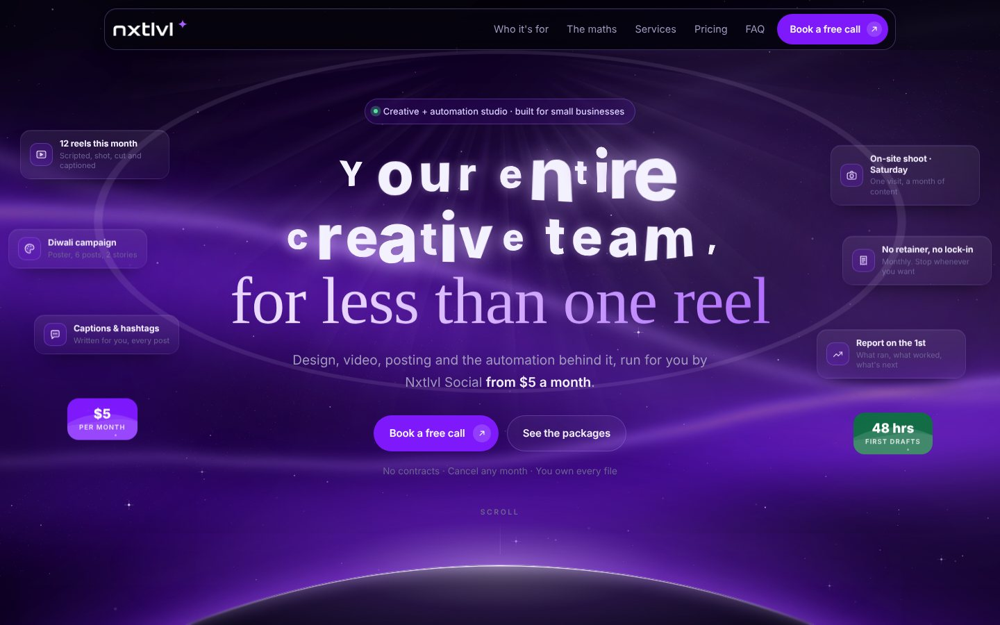
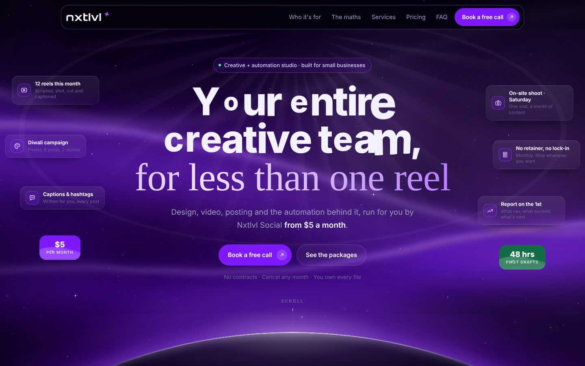
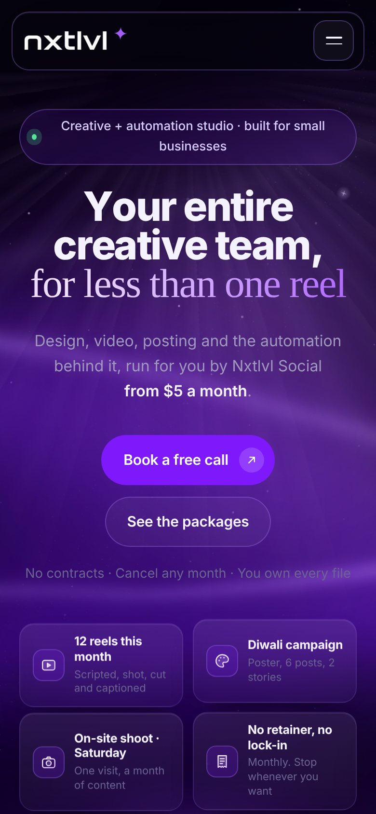
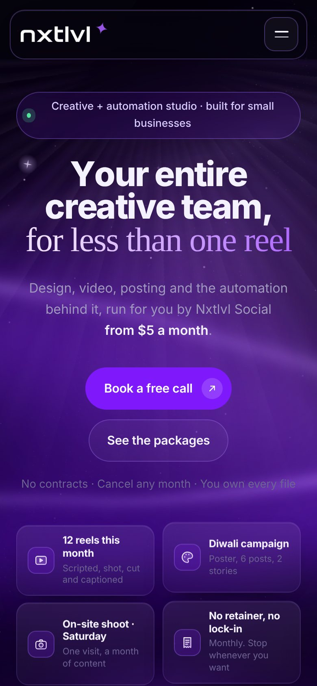

# Nxtlvl Social: SEO Audit

**Page:** `website/index.html` (the landing page; served locally because it is not deployed yet)  
**Date:** 23 October 2026 (first audit, then re-checked the same day after fixes)  
**Business type:** Agency (creative + automation studio for small businesses), with local service-area signals (India, on-site shoots)

## SEO Health Score: 76/100 (was 50, then 72)

| Category | Weight | Before | After |
|---|---|---|---|
| Technical SEO | 22% | 48 | 68 |
| Content Quality | 23% | 60 | 66 |
| On-Page SEO | 20% | 50 | 78 |
| Schema / Structured Data | 10% | 5 | 80 |
| Performance (CWV) | 10% | 62 | 72 |
| Images | 5% | 85 | 92 |
| AI Search Readiness | 10% | 45 | 65 |

The page now has the metadata, structured data, share card and crawl files it was missing. Its text is visible to search-engine renderers, and the headline paints sooner. The colours and motion are unchanged. What is left needs facts from the business or a live site: real contact details, the confirmed domain, a city, team and client proof, and deployment.

## What was fixed

- Complete document: `<!doctype html>`, `<html lang="en-IN">`, `<head>`, `<body>`.
- New title, meta description and canonical tag.
- Open Graph and Twitter card tags, with a new 1200×630 share image (website/og-image.png).
- Favicon (SVG and PNG), apple-touch-icon and theme-color.
- Organization and WebSite JSON-LD, including the three plans and their prices.
- robots.txt and sitemap.xml.
- Testimonial placeholders moved off the live page into a `<template>`.
- "Book on WhatsApp" and "Email us" buttons in the contact section; the email, number and FAQ WhatsApp mention are now links.
- Text stays visible for search-engine renderers: no manifesto pin, intro, letter flight or label scramble in a viewport taller than any screen.
- Headline waits at most 1.5 s for the animation library; GSAP is self-hosted.
- The savings odometer exposes its real value as text.
- A space before each ` ` inside headings.

## Round 2 fixes (25 October 2026)

- Fonts are served from the site (`website/fonts/`, Open Font License) and the two above-the-fold fonts are preloaded. There is no third-party request before first paint any more.
- Lab LCP after this round (three runs, local server): desktop 0.95–1.17 s, desktop first visit with the intro 1.61–1.88 s (was 1.36–2.76 s), mobile 0.68–0.84 s. The headline letters now fly for 1.3 s instead of 1.7 s.
- Web app manifest (`site.webmanifest`) and `robots` meta (`index, follow, max-image-preview:large`).
- Hero copy now names the service: "Social media + automation studio" and "Social media design, reels, posting and the automation behind it".
- Industry chips and footer links have a 44 px tap height: small tap targets down from 29 to 14 (desktop) and 38 to 24 (mobile).
- The logo is one cached `logo.png` with width and height set, instead of two inline copies.
- `llms.txt` added (listed for completeness; no ranking weight).

Health score after this round: **76/100** (Technical 72, Performance 80, On-Page 80; other categories unchanged).

## Corrections to the first audit

- The first audit called the testimonials "made-up quotes". On closer reading they were openly labelled empty cards ("real quotes from real clients go here"), not invented reviews. Keeping them off a live page was still right.
- The first audit said headings ran words together at line breaks. That came from the parse_html.py extractor, which joins text without spaces; browsers and Google read the words correctly. A space before each ` ` was added anyway.
- The first audit said the cost comparison had no label. The page already labels it as illustrative "typical market rates"; only the source is missing (now Low).

## Top open issues

1. **Critical:** The site is not live, so nothing can be indexed (Technical SEO)
2. **Critical:** The contact details are still placeholders (Search Experience)
3. **High:** Weak experience and trust signals (E-E-A-T) (Content Quality)
4. **High:** One page has to rank for everything (Content Quality)
5. **High:** No city or service area anywhere on the page (On-Page SEO)

## Screenshots

| Before | After |
|---|---|
|  |  |
|  |  |

## Technical SEO: 68/100 (was 48)

**What works**

- All page copy is in the HTML itself, so any crawler sees it without running JavaScript.
- Fixed: the file is now a complete document: `<!doctype html>`, `<html lang="en-IN">`, `<head>` and `<body>`.
- Fixed: canonical tag, robots.txt (welcomes search and AI crawlers, links the sitemap) and sitemap.xml are ready in website/.
- Fixed: favicon (SVG and 48 px PNG), apple-touch-icon and theme-color.
- Fixed: in a Googlebot-style render (viewport stretched to the page, no scrolling) 121 of 122 text blocks are visible, up from 61 of 139. The pinned manifesto no longer stretches the page to 128,000 px; renderers get it as plain text, and visitors still get the full animation.
- Fixed: GSAP is served from the site itself (website/vendor/gsap-3.14.2/), not a third-party CDN.
- Mobile viewport set, no sideways scroll at 390 px or 1440 px, no JavaScript errors, skip link, single h1, reduced-motion mode.

### Critical: The site is not live, so nothing can be indexed

The page only exists in the repo and as a private claude.ai artifact. HTTPS, redirects, security headers and real-user Core Web Vitals can only be checked once it is on a public domain.

**Fix:** Deploy the whole website/ folder (index.html, vendor/, the icons, og-image.png, logo.png, robots.txt, sitemap.xml) to the domain root over HTTPS with gzip or brotli on, then re-run this audit against the live URL.

### Medium: The domain is assumed, not confirmed

The canonical tag, og:url, og:image, the JSON-LD, robots.txt and sitemap.xml all use https://nxtlvlsocial.ai/, the domain from the page's placeholder email.

**Fix:** If the real domain is different, replace nxtlvlsocial.ai in those places before launch. A comment at the top of index.html lists them.

### Low: three.js still loads from a third-party CDN

The finale's three.js module is imported from cdn.jsdelivr.net, but only when the visitor reaches the end of the page, so it does not affect loading.

**Fix:** Optional: self-host it next to GSAP when the site is deployed.

## Content Quality: 66/100 (was 60)

**What works**

- 2,848 words of plain, specific copy; no filler and no AI-writing patterns (quality 95/100).
- A 12-question FAQ that answers the real objections, transparent pricing and a clear week-by-week first month.
- Fixed: the empty testimonial cards are off the live page. They sit in a `<template>` in index.html, ready to restore once there are real quotes.
- The cost comparison is already labelled on the page as illustrative "typical market rates".

### High: Weak experience and trust signals (E-E-A-T)

No founder or team, no About section, no real client work or results, and no location.

**Fix:** Add a short "Who makes this" block with names and faces, two or three real client examples with numbers, and the city you work from. Then restore the testimonials with real quotes.

### High: One page has to rank for everything

All services, industries and prices sit on one URL.

**Fix:** After launch, add one page per core service and per main industry (cafés, salons, gyms, clinics), linked from the home page sections that already exist.

### Low: Say where the "typical market rates" come from

The comparison ($35 per freelance reel) is labelled as illustrative but names no source.

**Fix:** Add one line on the source, for example "from quotes we collected from N freelancers in 2026".

### Low: Repetition flag from the content checker

Repetition score 32, driven by words like post, reel and month. Normal for a services page.

**Fix:** No action needed.

## On-Page SEO: 78/100 (was 50)

**What works**

- Fixed: title "Social Media Content & Automation from $5/mo | Nxtlvl Social" (60 characters).
- Fixed: meta description with who, what, price and a call to action (153 characters).
- Fixed: Open Graph and Twitter card tags with a 1200×630 share image, so links shared on WhatsApp, Instagram and LinkedIn show a proper card.
- One h1, a logical outline of headings, clear anchor navigation.

### High: No city or service area anywhere on the page

The page signals India (+91, .in, Diwali, Ganpati) and offers on-site shoots "within our service area", but never names a city, so it cannot rank for "social media agency in `<city>`" or show in local results.

**Fix:** Name the city and shoot area (hero trust line, the FAQ answer about shoots, footer), add it to the JSON-LD areaServed, and set up a Google Business Profile as a service-area business.

### Low: No links to the business's social profiles

A social media agency with no link to its own Instagram misses a proof point and an entity signal.

**Fix:** Link Instagram (and other active profiles) from the footer and contact section, and add them to the JSON-LD as sameAs.

## Schema / Structured Data: 80/100 (was 5)

**What works**

- Fixed: Organization and WebSite JSON-LD (valid JSON) with name, URL, logo, image, description, slogan, areaServed (India) and knowsAbout.
- Fixed: an OfferCatalog of the three plans (Content & Design, Video & Editing, Social + Automation) with their monthly starting prices in USD.

### Medium: Add contact details and profiles to the schema once they are real

email, telephone and sameAs are left out on purpose while the contact details are placeholders.

**Fix:** When the real email, WhatsApp number and Instagram handle are in, add "email", "telephone" and "sameAs" to the Organization block, then test with the Rich Results Test and validator.schema.org.

### Info: Do not add FAQPage or Review markup yet

Google retired FAQ rich results for all sites on 7 May 2026, and there are no real reviews yet.

**Fix:** Add Review markup only for real, attributable client reviews.

## Performance (CWV): 72/100 (was 62)

**What works**

- Fixed: the headline no longer waits on a third-party CDN, and never waits more than 1.5 s for GSAP. Lab LCP is now 1.47 s on desktop (was 2.64 s) and 0.94–1.07 s on mobile.
- Fixed: GSAP is self-hosted; the page is ready (DOMContentLoaded) in 936 ms on desktop, down from 1624 ms.
- Layout stays stable: CLS 0.0005 desktop, 0.003 mobile.
- The 3D headline, manifesto and every other animation still play for visitors.

### Medium: First visits measure slower because of the opening intro

On a first visit the intro plays and the headline letters fly in, and LCP counts that flight. Lab LCP for first visits was 1.36–2.76 s across runs. That is within the 2.5 s limit at best and just over it at worst. The sandbox uses a software GPU, so real devices should be faster.

**Fix:** After launch, watch LCP in Search Console. If the 75th percentile is over 2.5 s, start the letters closer to their place or shorten the flight from 1.7 s.

### Medium: One very large HTML file

index.html is about 365 KB (about 100 KB gzipped) with the CSS and JS inline.

**Fix:** Serve it with gzip or brotli; move CSS and JS into cached files once there is more than one page.

### Medium: Large DOM: 2,230 elements

Mostly decorative layers (odometer columns, the sample feed, particles and glints).

**Fix:** Build the decorative parts when they scroll into view.

### Medium: Render-blocking Google Fonts stylesheet

Three font families load from fonts.googleapis.com before first paint.

**Fix:** Self-host Latin WOFF2 subsets and preload the two used above the fold.

### Low: Interaction responsiveness (INP) not measured

No field data before launch; several continuous animations run.

**Fix:** Test on a mid-range Android phone after launch; target INP under 200 ms.

## Images: 92/100 (was 85)

**What works**

- Fixed: og-image.png (1200×630) in the brand violet with the headline, plus logo.png for the schema.
- Both inline images have alt text; total image weight on the page is about 13 KB.

### Low: The logo is embedded twice as base64 PNG

Two inline copies of a 6.4 KB PNG; they can't be cached.

**Fix:** Reference website/logo.png (or an SVG version) instead when the site is deployed.

### Info: No real work in image form

The page shows mock posts, not real client work.

**Fix:** Add approved client work as WebP/AVIF with descriptive alt text and file names.

## AI Search Readiness: 65/100 (was 45)

**What works**

- Server-rendered content and short, quotable FAQ answers.
- Fixed: the Organization schema states who the business is, what it offers and at what price.
- Fixed: robots.txt explicitly welcomes AI search crawlers.
- Fixed: the savings number now reads "$405" as text (the rolling digits are drawn by CSS), for crawlers and screen readers alike.

### Medium: Entity signals are still thin

No sameAs links, no city, no named people, so AI answers have little to connect "Nxtlvl Social" to.

**Fix:** Add profile links and the city (see On-Page and Schema), and keep the business name and description identical on Instagram, Google Business Profile and directories.

### Low: No llms.txt

Listed for completeness only; it carries no weight in this score.

**Fix:** Optional.

## Search Experience (not weighted)

**What works**

- Fixed: "Book a free call" now lands on a "Book on WhatsApp" button (opens WhatsApp with a pre-filled message) and an "Email us" button; the email and number are links too.
- The mobile first screen shows the headline, subhead, both buttons and the trust line.
- The price is in the hero and the FAQ handles the main objections.

### Critical: The contact details are still placeholders

The new buttons and links point to +91 00000 00000 (wa.me/910000000000) and connect@nxtlvlsocial.ai, which the page itself flags as placeholders.

**Fix:** Replace the number and email everywhere they appear in index.html (the comment at the top lists the places), then remove the "Placeholder contact details" note.

### Medium: Prices in dollars, everything else says India

USD prices ($5, $15, $49) next to Indian contact details, festivals and examples.

**Fix:** Confirm the target market; if it is India, show ₹ (optionally with $ for overseas clients) and update priceCurrency in the JSON-LD.

### Low: Many small tap targets

40 of 66 tappable elements on mobile are under 44×44 px, mostly industry chips and inline links.

**Fix:** Give chips and footer links at least 44 px of tappable height.

## Limitations

- Not deployed: HTTPS, redirects, security headers and field Core Web Vitals could not be tested.
- No Google Search Console, GA4, CrUX, Matomo, Moz or DataForSEO access: no rankings, traffic, backlinks or field data.
- Lab timings come from a sandboxed headless Chromium with a software GPU and the font CDN stubbed; they vary between runs, so ranges are given.

Raw tool output: `raw/` (first audit) and `raw/after/` (re-check). Per-category detail: `findings/`. Plan: `ACTION-PLAN.md`.
